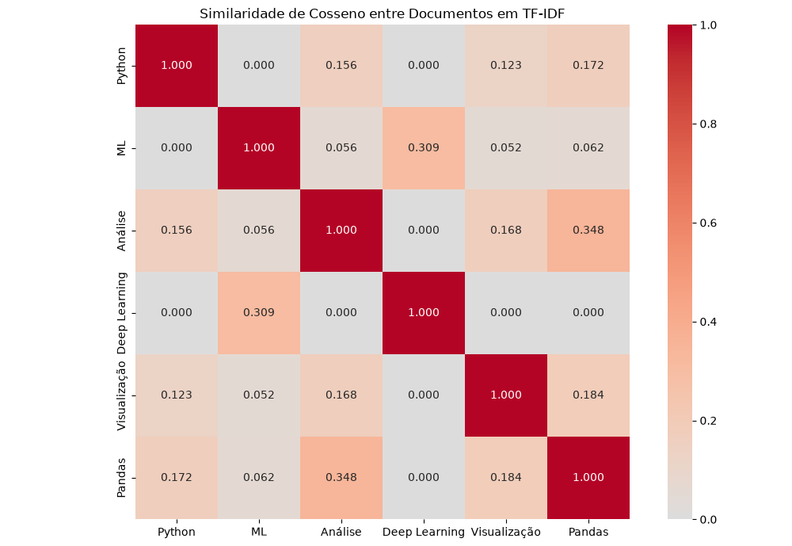

# TF-IDF
A ideia é reconhecer como o TF-IDF dá nota alta para as palavras que aparecem muito em um documento específico (Term Frequency), mas em poucos documentos de toda a coleção (Inverse Document Frequency).

## Pipeline de Similaridade Textual (PLN)
A estrutura do programa segue as seguintes premissas:
 - Converter os textos em vetores TF-IDF
 - Carregar textos em um DataFrame (pandas)
 - Calcular a similaridade de cosseno entre os pares do documento
 - Visualizar o resultado, com bibliotecas gráficas (matplotliv/seaborn)

#### Resultado
Top 5 palavras mais importante por documento:

Python:
 linguagem: 0.4550
 poderosa: 0.4550
 programação: 0.4550
 versátil: 0.4550
 python: 0.3150

ML:
 algoritmos: 0.3864
 aprender: 0.3864
 nos: 0.3864
 padrões: 0.3864
 utiliza: 0.3864

Análise:
 com: 0.4133
 eficiente: 0.4133
 muito: 0.4133
 popular: 0.4133
 análise: 0.3389

Deep Learning:
 learning: 0.6502
 deep: 0.3965
 do: 0.3965
 subcategoria: 0.3965
 machine: 0.3251

Visualização:
 de: 0.4564
 ajuda: 0.3846
 interpretação: 0.3846
 na: 0.3846
 resultados: 0.3846

Pandas:
 biblioteca: 0.4538
 essencial: 0.4538
 pandas: 0.4538
 análise: 0.3721
 python: 0.3142

   
